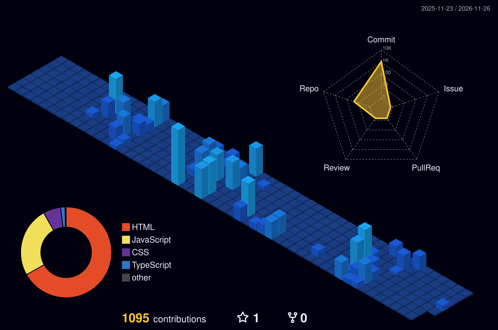

# SHADID AHAMED

**CSE Student · Creative Developer · Designer**  
Dhaka, Bangladesh

[GitHub: @shadidahamed](https://github.com/shadidahamed)

---

## 01 / THE INTRODUCTION

  
  <a href="./hero.svg">Open the animated SVG source</a>

## 02 / OUTSIDE THE CODE

  
  <a href="./about-life.svg">Open the animated SVG source</a>

## 03 / THE STACK

  
  <a href="./stack.svg">Open the animated SVG source</a>

## 04 / IDENTITY & DASHBOARD

  
  <a href="./id-dashboard.svg">Open the animated SVG source</a>

## 05 / CONNECT

  
  <a href="./connect.svg">Open the animated SVG source</a>

## 06 / CONTRIBUTION CITY

After the first successful GitHub Actions run, the 3D contribution calendar is generated here:

  

The workflow is included at [`.github/workflows/profile-3d.yml`](./.github/workflows/profile-3d.yml). It runs daily and can also be started manually from the **Actions** tab. The first image appears only after that workflow completes.

## TOOLKIT

`HTML` · `CSS` · `JavaScript` · `Three.js` · `C++` · `Java` · `Blender`

## CREATIVE INTERESTS

Digital art · Game development · Drawing · Storytelling · 3D design

---

**CODE IN THE DARK. CREATE IN THE LIGHT.**

Hand-crafted SVG artwork · embedded character images · no JavaScript in the profile assets

GitHub renders SVG without animation, so the profile uses local GIF previews for motion. The linked SVG sources retain CSS + SMIL animation for direct browser viewing.

